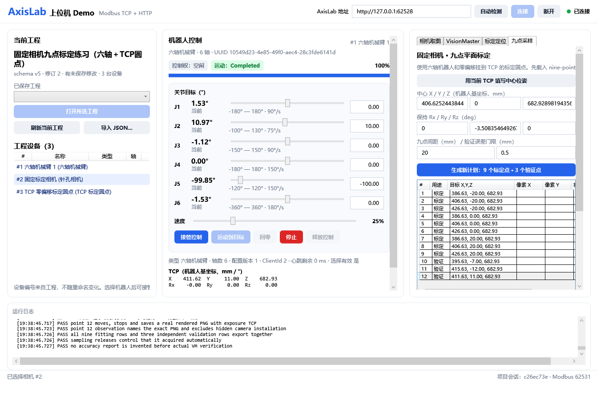

# 从九点采样到 VisionMaster 与 WPF 集成

适用：AxisLab 0.7.0、AxisLab.WpfDemo 1.2.0、VisionMaster 4.3.0。先完成固定相机的 XY 平面映射；本练习不求解相机内参，也不求解完整三维手眼变换。

## 1. 启动练习

1. 启动新版 AxisLab。导入 `Samples/nine-point-calibration.scene.json`（源码目录为 `samples/`）。
2. 启动新版 WPF，点击“自动检测”并连接，或填写 AxisLab 的实际 HTTP 地址。
3. 在左侧先选六轴机械臂，再选固定标定相机。选择相机后，机器人选择仍然保留。
4. 打开“九点采样”，点击“用当前 TCP 填写中心位姿”。保持间距 20 mm，首次用 25% 或更低速度。
5. 点击“生成新计划”。表中 1—9 为标定点，10—12 为独立验证点。这里的 12 个点不是 VM 的“九次平移＋三次旋转”；后三个点全是未参与拟合的平移验证位置。

示例中的白色方片带一个黑圆，圆心严格位于 TCP 原点。它以零局部位姿挂到机器人的 `tool`。相机固定在上方，TCP 朝上，标定平面约为 Z=682.93 mm；以读取到的实际值为准。不要手动照抄四舍五入的中心坐标。

## 2. 采集九点与独立验证图

对表中每一行执行：选中行 → “预检并移动到所选点” → 等待停稳 → “采集所选点”。对 1—12 全部完成后点击“导出配对表 points.csv”。每次生成计划都会创建新目录，已有样本保留。

文件默认在 `%LOCALAPPDATA%\AxisLab.WpfDemo\calibration-samples\nine-point-...`。也可以在“标定定位”页更改采样根目录。

| 文件 | 用途 |
| --- | --- |
| `p01-<帧号>.png` 等 | 送入 VM 的实际照片 |
| 同名 `.observation.json` | 该照片曝光时的关节、法兰/TCP 位姿与矩阵 |
| `plan.json` | 计划、设备绑定、目标位姿和已采集记录 |
| `points.csv` | 逐行图像名、用途、像素坐标及曝光时实际 TCP 坐标 |
| `validation-report.json` | 在记录三个真实 VM 验证结果后生成的误差报告 |

物理坐标使用 CSV 的 `robot_x_mm/robot_y_mm`，它们来自曝光时实际 TCP，不能拿计划值或拍完后读到的当前位置替代。像素坐标可先留空。不要从完整帧元数据里抄相机真值来代替标定。

采样中切换工程、设备或改变场景配置会使计划失效，需要生成新计划。窗口重开后的首版向导不自动恢复旧计划；旧图像和 CSV 仍可用于 VM 离线练习。

## 3. 在 VM 中测量圆心

新版 WPF 的采样页如下；右侧内容较长时向下滚动，表格右侧可横向滚动查看状态。

1. 在 VM 新建方案和流程，加入“图像源”，选择本地图像，先打开 `p01-...png`。
2. 图像源选择本地图像、MONO8，先关闭“自动切换”，再添加“圆查找”。在白色方片的黑圆上绘制圆环 ROI，使内外圈夹住圆边缘。边缘极性选择“黑到白”（VM 从圆心向外定义极性），使结果得到一个圆心；不要选中机械臂的黑色关节。
3. 对 1—9 的九张照片依次运行，记录每一张的圆心 X/Y（像素）。首次练习可在每次换图后把圆环 ROI 手动移到该图的黑圆上，再执行；熟悉后使用初定位或粗定位＋精定位。保持图像源的原始 800×600 尺寸，不裁剪或缩放输入。
4. 把每张照片的圆心坐标与 `points.csv` 同一行的实际机器人 X/Y 配对。可在 WPF 表的“像素 X/Y”列填入后重新导出。

图像 X 向右、Y 向下，单位 px；机器人坐标使用所选机器人的基坐标，单位 mm。不要手动翻转 Y 或乘一个经验比例；映射由下一步求出。九个点不能按“VM 返回顺序”与机器人表自动猜配对，必须按文件名和行号一一对应。

## 4. 在 VM 中完成 N 点标定

在模块库搜索“N点标定”，按照本机 VM 4.3 帮助配置：

1. “标定点获取”选择“手动输入”。在编辑标定点表中逐行填写九组图像 X/Y 与物理 X/Y；物理值使用 CSV 实际 TCP 的基坐标。
2. 平移次数设为 9，旋转次数设为 0。关闭“使用相对坐标”，本练习需要绝对机器人基坐标。
3. 相机模式选择“相机静止上相机位”。自由度保留默认透视变换；本例正对平面，仿射模型也可另作比较，但先按同一种模型完成练习。
4. 执行标定，检查“标定状态”成功和误差是否正常。设置标定文件路径，使用“生成标定文件”保存；文件扩展名遵循本机 VM 的保存对话框。
5. 保存 `.sol`。标定文件与 `.sol` 放在固定项目目录，若方案引用外部标定文件，移动电脑时一并保留并重新核对路径。

VM 支持导入它自己的 TXT 点集格式；本项目 `points.csv` 是通用配对表，不能直接假定与厂商 TXT 格式相同。首次用手动逐行填写；如需批量导入，先从本机 VM 导出一份空白/示例点集，按它的实际格式转换。

圆点不包含可测的方向信息，所以本练习不估计工件旋转角，也不做旋转轴中心标定。后续识别带方向的目标时再增加角度约定与验证。

## 5. 建立运行时定位流程

建议把标定调试与运行时定位分成两个流程，定位时不要反复覆盖标定文件：

`图像源 → 灰度/圆心检测 → 标定转换 → 有效性判断 → 流程输出`

“标定转换”加载刚生成的标定结果，将当前检测到的像素圆心转为绝对物理坐标。首次用标定图做基本检查，然后用 `p10/p11/p12` 验证图检查；后三张不得加入拟合。

在流程配置的“输入设置 / 输出设置”中声明下表字段，并关联本帧处理结果。这些是流程接口，不只是某个圆查找模块内部的结果名称。

| 方向 | 名称 | 类型 | 赋值 |
| --- | --- | --- | --- |
| 输入 | `AxisLabRequestId` | 整数 | WPF 每次传入；VM 调试时可手动给测试值 |
| 输出 | `ResultRequestId` | 整数 | 本帧处理完成后回传对应请求编号 |
| 输出 | `CalibrationOk` | 整数 0/1 | 标定文件有效且转换模块运行成功 |
| 输出 | `TargetOk` | 整数 0/1 | 本帧恰好识别一个合格目标 |
| 输出 | `RobotX` | 浮点数 | 标定转换后的绝对基坐标 X，mm |
| 输出 | `RobotY` | 浮点数 | 标定转换后的绝对基坐标 Y，mm |
| 输出 | `RobotRz` | 浮点数 | 本练习已知固定姿态，可用固定 0°；这不代表测出了角度 |

每个字段应只返回一个值。标定状态若在 VM 中是浮点型，需先判断再转换为整数 0/1。不要把像素坐标直接接到 `RobotX/RobotY`，也不要把 `CalibrationOk` 永久设为 1。

流程每次开始先清空有效标志，识别失败、多个目标或标定文件无效时输出 NG；失败分支也须发布本次请求编号。使用分支、变量计算或脚本组织这些赋值时，要确保成功和失败路径都执行到最终输出，避免保留上次成功结果。把 `ResultRequestId` 作为本帧完成发布的一部分，不能用上一次编号。

保存实际流程名、图像源模块名和 `.sol` 路径。WPF 连接时会在内存中把图像源切到 SDK 模式，不覆盖你的磁盘方案。

## 6. 集成到现有 WPF

界面操作：

1. 在 WPF “VisionMaster”页选择 `.sol`，填写实际流程名与图像源名，核对字段名，点击“加载 VM 方案”。
2. 首次加载会初始化本机 VM SDK，最多等待 90 秒；运行流程仍有独立的 20 秒超时。可随时用中间“停止”取消。若加载失败，先确认本机 VM 本身可以打开并运行该方案，以及 SDK 授权和相关模块是否可用。若报 `0xE0000700`，厂商将其定义为“加密狗未检测到或检测异常”，需要检查 SDK 的授权识别；WPF 不会绕过授权。
3. 重新拍照后点击“将当前帧送入 VM 图像源自检”。成功说明同一帧像素进入 SDK，此按钮不生成机器人目标。
4. 点击“送图并运行用户视觉流程”，检查 `RobotX/RobotY/RobotRz` 及有效标志。
5. 在“标定定位”页填写标定方案标识并绑定。该按钮记录依赖关系，不计算标定系数。
6. 设置 Z、Rx、Ry，点击预检，成功后执行一次定位。每次执行之后都需要新拍照、新结果和新预检；结果超过 30 秒或场景已改变时应重拍。

代码职责：

| 文件 | 你以后修改自己的上位机时应关注的地方 |
| --- | --- |
| `MainWindow.Calibration.cs` | 采样计划、运动、拍照和导出 |
| `CalibrationPlan.cs` | 数据配对、失效规则、独立验证报告 |
| `MainWindow.Vision.cs` | 加载、送图、读取结果、预检及单次定位 |
| `VmBridgeClient.cs` | .NET 9 与配套进程之间的命名管道 |
| `VmSdk/VisionService.cs` | 在 .NET Framework 4.8 中调用真实 VM SDK |
| `ExternalControlSession.cs` | 机器人控制权、心跳与 Modbus 命令 |

主 WPF 保持 .NET 9；配套 VM Bridge 使用 .NET Framework 4.8，并引用本机厂商程序集。不要把厂商 .NET Framework 程序集直接塞进 .NET 9 主进程。构建配套进程用 `src/WpfDemo/build.ps1`；本机 SDK 路径不是默认位置时，在构建中指定 `VmRoot`，运行时设置 `AXISLAB_VM_ROOT`。

## 7. 独立验证与单次引导

完成 VM 方案后，在 WPF 九点表中选点 10 → 移动 → 重新采集 → 运行 VM → 回到九点页“记录所选验证点的当前 VM 结果”。对 11、12 重复。点击“生成独立验证误差报告”，查看 RMS、最大误差以及是否满足你设置的门限（默认 0.5 mm，是练习门限，不是硬件精度承诺）。更换 `.sol` 或字段映射后需要重新采样验证，不能混用不同方案的误差。

验证报告测的是图像到平面坐标的误差。机器人完整视觉引导精度还要用实际目标与到位 TCP 检查，不能把报告等同于完整抓放验收。

若想尝试独立目标：先完成并保存上述报告，再在 AxisLab 隐藏 TCP 圆点，添加一个独立“TCP 标定圆点”作为静态目标，放到同一高度平面并置于原九点覆盖区域内。不要改变相机与机器人安装、几何及 TCP。改变场景后重新拍照检测和绑定。

本示例 TCP 朝上，首次只做从下方接近，例如目标 Z 取标定平面 Z 减 25 mm；保持 Rx/Ry/Rz 与示例一致，先预检。这样可以观察机器人移动到目标下方，避免直接穿入靶板。实际抓取姿态、夹爪和接触动作留待后续阶段。

## 8. 常见问题

- 看不见黑圆：确认使用新版 AxisLab，TCP 圆点可见且零偏移挂在 `tool`；固定相机方向正确，AxisLab 渲染窗口保持打开。
- 提示不在所选点：先移动并停稳再采集；不要给其他点的图片填当前行。
- VM 只找到像素、没有毫米：补上 N 点标定与标定转换，输出绝对基坐标。
- WPF 缺少字段：检查流程输入/输出配置、类型和真实名称；SDK 自检成功不代表字段已配置。
- 请求编号不匹配：检查失败分支和输出发布顺序，确保当前帧回传当前请求编号。
- 预检拒绝：先看不可达、碰撞或姿态原因；本版本采用 MoveJ，不自动规划绕障。
- 重开窗口后旧绑定消失：重新加载方案、拍照运行并绑定；绑定以当前会话为准。

## 官方资料与本机依据

本教程的 VM 参数含义依据本机 4.3.0 安装目录中的 `Applications/Help/CH`：N点标定、标定转换、输入输出配置，以及 `Development/V4.x/Includes/IVmNPointCalib.h`。不同版本布局可能变化，以本机帮助为准。

厂商功能概览：[VisionMaster 官方页面](https://www.hikrobotics.com/cn/machinevision/visionmaster/)。模块结果说明：[官方标定帮助](https://pinfo.hikrobotics.com/hkws/unzip/20231101163730_26101_doc/GUID-325D816D-75BC-462B-857E-D49727A2388C.html)。

本机额外检查已记录厂商依赖 DLL 与新桌面 EXE 被 Windows Code Integrity 策略阻止；详见[本轮验收记录](阶段7B验收记录.md)。这部分需要在受信任、获授权的运行环境中解决，教程未修改本机安全策略。
