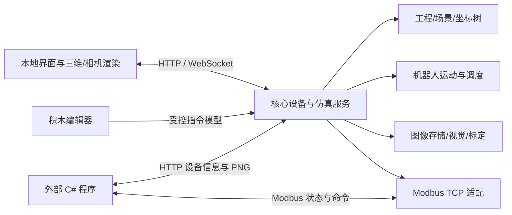

# 机械臂与相机仿真平台总体设计 v0.3

2026-10-21 方向修订：后续视觉与标定流程由用户在 VisionMaster 中搭建，独立 WPF 通过 SDK 调用并控制 AxisLab。新的职责划分和里程碑以[VisionMaster与WPF集成设计](VisionMaster与WPF集成设计.md)为准；本文原有内置视觉/积木规划不再作为当前实现路线。

日期：2026-10-20。状态：设计基线，阶段 1 场景编辑器、桌面包装、阶段 2 基础运动和阶段 3 拍照传图及阶段 4 外部控制/三轴已实施。本文描述目标架构，实际实现范围以[阶段 1](阶段1验收记录.md)、[阶段 2](阶段2验收记录.md)、[阶段 3](阶段3验收记录.md)、[阶段 4](阶段4验收记录.md)及桌面验收记录为准，未验证的技术和数值均为规划目标。

## 1. 软件定位与范围

软件面向机器人、视觉和通信练习。用户从空白工程开始，添加机械臂、相机及辅助对象，配置设备位置和连接关系，在虚拟环境中操作、编程、拍照、传图、标定，再通过 C# 控制和观察。

平台核心不依赖具体生产流程。传送带分拣、多工位搬运、固定相机定位、末端相机观察都作为可保存、可修改的场景模板。

| 层级 | 内容 | 交付顺序 |
| --- | --- | --- |
| 通用底座 | 工程、场景、设备实例、挂载、统一状态与日志 | 最先 |
| 基础设备 | 六轴机械臂、可添加相机、夹具与几何对象 | 逐项增加 |
| 对外能力 | 状态、命令、拍照、PNG 输出、C# 接收、Modbus | 早期打通 |
| 训练工具 | 示教、积木、图像检测、内参/手眼/坐标标定 | 基础闭环后 |
| 场景扩展 | 输送、传感器、工位、抓放业务与教学模板 | 后期组合 |

首批支持单机械臂运动与至少两台相机独立抓图；数据结构支持添加多个机器人实例，首版不承诺多机器人协同、任意品牌精确控制模型或无限设备规模。单目图像、运动学和教学抓放先行，真实电气 IO、硬实时、力控和复杂动力学后续评估。

## 2. 最小可用版本

最早可验收的完整版本必须做到：

1. 创建空白工程，添加一个六轴机器人和两台相机；不强制出现传送带。
2. 修改设备名称、安装位姿、相机分辨率/成像参数；一台相机固定，另一台可挂到机器人末端。
3. 调节关节，画面与核心状态一致，末端相机随挂载对象运动。
4. 按指定相机拍照，界面显示图像；保存 PNG，并能从外部 C# 获取同一帧 PNG。
5. 外部 C# 读取设备列表/状态，经 Modbus 读机器人状态、下发一个受限关节动作或相机拍照命令。
6. 保存、关闭、重新打开工程，设备 ID、安装关系和通信映射保持一致。

“添加相机”与“显示三维场景主视图”是两项能力：每台相机必须按自己的位姿与成像参数渲染，不能把界面截图当成所有相机的输出。初期单次抓图即可，连续预览在资源测量后增加。

## 3. 界面规划

| 区域 | 主要内容 |
| --- | --- |
| 顶部工具栏 | 新建/保存、编辑/运行模式、运行/暂停/停止、仿真时间 |
| 左侧设备库与场景树 | 添加设备、选择对象、查看挂载层级、显示/隐藏 |
| 中央三维场景 | 移动/旋转对象、坐标轴、视锥、机器人轨迹 |
| 右侧属性面板 | 所选对象属性、关节、相机参数、挂载、通信映射 |
| 下方工作区 | 相机画面与帧信息、积木编辑、示教点、标定向导 |
| 状态与日志区 | 命令进度、通信连接、错误、事件和导出 |

基础版不需要同时显示所有面板。编辑模式允许改拓扑，运行模式允许受控参数及动作；运行中删除设备、切换挂载、修改机器人几何等操作必须先停止并处理引用。

## 4. 总体架构与技术基线

建议先采用 Windows 本地服务加本地 Web 界面。界面用 TypeScript、Three.js，后续加入 Blockly；核心用 C# 和受支持的 .NET LTS，HTTP/WebSocket 由 ASP.NET Core 提供。视觉算法通过兼容的 OpenCV 绑定接入。版本和发布方式在阶段 1 的依赖原型完成后锁定。



核心持有场景和设备状态，界面负责显示与相机渲染。设备命令统一进入调度器，界面、积木和外部 C# 不能各自维护一套机器人位置。桌面封装已前置实现：WPF/WebView2 窗口与 ASP.NET Core 服务处于同一进程，使用动态本机端口，关闭窗口停止服务；终端模式仍可独立运行 Host。

早期相机依赖已连接的渲染界面。界面关闭或失联时，抓图明确失败；不能假设后台服务仍可独立拍照。无界面运行和独立渲染进程是后续扩展。多个界面连接时只有被核心授权的渲染会话可提交抓图结果。

| 模块 | 责任 | 不应承担的业务 |
| --- | --- | --- |
| ProjectService | 工程读写、版本升级、资源引用 | 固定创建三个工位 |
| SceneService | 对象树、位姿、挂载、快照 | 从名称推断设备身份 |
| DeviceRegistry | 类型、实例、能力、生命周期 | 固定顶部/末端两个相机槽 |
| SimulationClock | 仿真步进、暂停、状态快照 | 用界面刷新率作为运动时间 |
| RobotService | 运动学、限位、轨迹、工具、状态 | 专用分拣工艺 |
| CameraService | 参数、触发、捕获任务、帧生命周期 | 把工件真值冒充图像识别 |
| ImageStore | 图片与元信息、下载、保留策略 | 将 PNG 塞进 Modbus 寄存器 |
| ProgramRuntime | 指令校验、执行、取消、超时 | 无限制执行积木生成的任意代码 |
| CalibrationService | 数据采集、求解、依赖与失效 | 读取隐藏安装真值作为求解结果 |
| CommunicationAdapters | HTTP、WebSocket、Modbus 的转换 | 绕过设备调度直接修改关节 |
| ScenarioServices | 工位、目标、输送及抓放规则 | 改写底层设备寻址规则 |

阶段内可先做同进程模块，不要求一开始拆成多个微服务或独立插件包。

## 5. 设备和坐标模型

### 5.1 通用对象

| 字段 | 约定 |
| --- | --- |
| id | 稳定 UUID，保存后不改变；复制对象生成新 ID |
| typeId / schemaVersion | 类型标识及配置版本，如 robot.generic6r、camera.pinhole |
| name | 用户可改，仅用于显示 |
| parentId / attachmentFrameId | 场景父对象，以及可选的法兰/工具等挂载坐标系 |
| localTransform | 相对挂载系的平移与旋转 |
| parameters | 按类型验证的参数，如关节限位、分辨率 |
| capabilities | 支持的动作/数据，如 MoveJ、Capture、ReadImage |
| configurationRevision | 配置变更版本，参与标定和捕获一致性检查 |
| communicationBinding | 项目内设备编号与协议映射；不使用显示名称寻址 |

坐标树不得有环；删除或挂载变更须检查程序、标定、点位及其他设备引用。删除父对象时先显示影响，用户选择取消、连同子项删除或保持世界位姿解除挂载；运行中不执行这些破坏性编辑。复制仅复制配置，不复制运行命令、控制权或有效标定。

### 5.2 坐标约定

- 对外与工程文件：mm、deg；内部旋转采用归一化四元数/矩阵。渲染和视觉适配层显式转换单位与轴向。
- `T_A_B` 将 B 系坐标变换至 A 系：`p_A = T_A_B · p_B`。
- 相机坐标 X 向右、Y 向下、Z 向前；镜头内参与渲染投影参数由同一配置推导。
- 机器人基座、法兰、工具、相机、工件、标定板都是明确可引用的坐标系。
- 随动相机的世界位姿由曝光快照中的机器人位姿与安装外参计算，不能使用下载时的最新机器人位姿。
- 场景真实安装与用户估计的标定结果分开保存；练习控制使用估计值，渲染使用实际安装值，才能观察标定误差。

## 6. 相机拍照、预览和传图

### 6.1 捕获流程

1. 界面、积木或 C# 指定 cameraId 发起捕获，核心校验相机状态与渲染会话。
2. 创建 captureId，冻结 sceneRevision、配置版本、仿真时刻及需要的对象/机器人姿态快照。
3. 指定渲染端按冻结状态离屏渲染；可选执行畸变/噪声处理。不能直接渲染仍在变化的当前场景代替曝光快照。
4. 上传图片到对应 captureId；核心校验所属会话、相机、尺寸、配置版本和图片格式，完成后分配 frameId。
5. ImageStore 原子发布 PNG 与元数据，通知捕获完成。界面预览、保存和 C# 下载引用同一 frameId。
6. 失败/超时发布明确错误，清除本次有效标志，不把上一张成功图替代本次结果。

捕获状态：Queued → Capturing → Completed / Failed / Cancelled。首版每台相机最多一个在途捕获，忙时明确拒绝；后续增加有界队列。多相机共享 GPU 时按队列顺序渲染，不承诺同时曝光；需要同步拍摄时必须另行定义成组快照协议。

### 6.2 图像和元信息

每帧记录 projectSessionId、cameraId、captureId、frameId、仿真曝光时刻、完成时刻、尺寸、编码、相机参数版本、场景快照版本；随动相机增加机器人 poseId 与曝光位姿。后续传感器触发增加 triggerId。

PNG 是基础输出格式；后续预览可增加 JPEG，算法原始帧、预览压缩帧和标注图必须区分。界面叠加的坐标和识别框默认不写入原始图像。改变分辨率须明确内参缩放/重设规则并使相关标定失效。

外部 C# 接收的是图片二进制与独立元数据，可保存为文件或交给图像算法。Modbus 用于触发和读完成状态，HTTP 用于取图片；用户无须在第一版先安装真实相机厂商 SDK。

### 6.3 生命周期与边界

ImageStore 初始建议按每相机最近 20 帧且全局 256 MiB 上限执行淘汰，数值可配置并通过实测调整；显式保存/导出的图片不受临时缓存清理影响。下载时固定帧资源，淘汰不应截断正在下载的响应。

最新帧接口只供预览；业务控制先取得固定 frameId 再下载，避免一次读元数据、一次读图片却拿到不同帧。缓存帧已淘汰返回 410，未知资源返回 404，不能悄悄返回最新图。持续预览首版按低频请求实现，视频编码/推流另行扩展。

## 7. 机器人、执行和控制权

先实现关节运动和 FK、点动与限位，再实现 IK、MoveJ/MoveL、工具/工件坐标、基本碰撞和示教。每个机器人独立运行状态及取消令牌；多机器人实例可独立建模，协同轨迹后续处理。

动作统一表示为 commandId、deviceId、type、parameters、source、deadline；状态为 Accepted、Running、Completed、Failed、Cancelled。写请求成功与运动完成分开。重试携带相同请求 ID，不能重复执行已接受动作。

运动控制权按机器人分配，来源包括本地示教、积木运行时和外部客户端；同一机器人一次只有一个运动控制者。工程切换、停止和失联按约定撤销控制权。相机有独立捕获仲裁，不必因机器人运行中就拒绝拍照，但必须绑定准确曝光状态。

仿真时钟负责运动和场景设备，暂停时一致冻结；网络超时与连接心跳使用单调实际时钟，避免暂停后失联检测也停住。恢复工程不恢复运行命令、网络连接或持有的控制权。

## 8. 对外接口设计

下表为总体接口规划，含尚未实现的状态、命令及 WebSocket。阶段 3 已实现设备列表与相机捕获/状态/元数据/PNG 路由，精确返回字段、错误和 C# 示例以[相机 HTTP 接口](相机HTTP接口.md)为准。其余在相应阶段冻结，不能仅依据本规划假定可调用。未实现动作返回 Unsupported。

| 接口草案 | 作用 |
| --- | --- |
| `GET /api/v1/devices` | 列出设备 ID、类型、能力、协议映射 |
| `GET /api/v1/devices/{id}/state` | 获取版本化设备状态 |
| `POST /api/v1/cameras/{id}/captures` | 返回 202、captureId 与状态查询地址 |
| `GET /api/v1/captures/{captureId}` | 查询捕获状态，完成后取得固定帧引用 |
| `GET /api/v1/cameras/{id}/frames/{frameId}` | 取得帧元信息、曝光姿态及图片地址 |
| `GET /api/v1/cameras/{id}/frames/{frameId}/image` | 返回 `image/png` 二进制 |
| `POST /api/v1/robots/{id}/commands` | 提交受控机器人动作，返回 commandId |
| `GET /api/v1/commands/{commandId}` | 查询动作完成/失败/取消 |
| WebSocket `/api/v1/events` | 状态版本、捕获完成、动作状态、错误通知 |

WebSocket 事件带递增 eventSequence；断线后客户端重新查询当前状态补齐，不能仅依赖事件永不丢失。元数据带项目会话 ID，项目切换后旧 ID 无效，防止跨工程误读。

### Modbus 通用寻址原则

- 核心作 Modbus TCP 服务端，C# 作客户端；默认本机 1502，配置后可供局域网测试。
- 每个设备有工程内稳定的 UInt16 deviceNumber，0 保留；UUID 与 deviceNumber 映射保存到工程并可导出 JSON/CSV。
- 固定公共区用于版本、会话、能力和错误；命令区包括设备编号、命令、参数、提交序号；提交时原子锁存，按设备能力分发。
- 规划采用持有者专属的设备选择/结果窗口；窗口响应携带设备编号、快照序号和帧令牌，避免相机增删引起所有地址漂移。其他客户端读取固定公共区，详细状态通过自己的已绑定窗口读取。
- 阶段 4 必须用两个客户端验证窗口隔离，再冻结正式零基地址表、访问权限、浮点字序与设备发现方式。旧通信草案的固定双相机窗口仅作案例参考，不作为通用地址表。
- 提交序号、状态快照、业务错误、超时、取消和重复去重均需明确；目标已删除返回 DeviceNotFound，不能复用设备号指向另一个设备后继续执行旧命令。
- Modbus 只交换命令、数值、状态和帧索引，不传图片。Modbus 返回的会话与帧令牌须可通过 HTTP 解析到对应 cameraId/frameId；阶段 4 冻结完整映射与回绕规则。

初期相机帧令牌在项目会话内唯一，不能与 UUID 文本直接混用。重新打开工程生成新会话，设备编号保持，帧与命令运行态重新开始。工程内删除设备号先保留为废弃项，显式重建映射需提醒客户端重新加载并变更映射版本。

默认只监听本机；用户启用局域网时显式选择网卡并配置连接策略。首版不以互联网远程服务为目标。

## 9. 示教、拖拽编程与标定

示教点引用 robotId、工具/工件坐标和配置版本。积木通过 deviceId 选择设备，设备删除后显示未解析引用，不能改名或按数组序号自动绑定其他设备。积木编译为受控指令模型，经同一执行器运行，支持高亮、单步、断点、停止和等待超时。

标定作为可重复的训练流程，逐步加入：相机内参 → TCP/工作坐标 → 平面映射 → Eye-in-Hand → Eye-to-Hand → 工件与工位关系。基础抓图和对外传图不依赖这些算法先完成。

标定记录保存设备 ID、采样帧与机器人姿态、参数版本、单位、变换方向和质量报告。改动安装、内参、TCP 等按依赖链失效；移动标定板/工位需区分运行目标更新与安装关系改变。用独立数据验证，隐藏真值仅用于评分。

已有标定技术参考见[需求规格官方依据](需求规格.md#8-官方依据)，具体 OpenCV API/绑定以原型测试锁定。

## 10. 工程存储与代码结构

初期采用工程目录而非数据库，导入/导出时可打包；保存以临时文件写入后替换，避免半写主配置。工程是数据，不执行其中携带的任意脚本。

```text
project/
  project.json             # 工程版本、单位、场景、设备、稳定 ID 与通信映射
  assets/                  # 本地模型、标志与材质；许可证信息随资源保存
  programs/                # 积木工作区与受控指令模型
  teaching/                # 示教点、工具和工件坐标
  calibrations/            # 采样清单、求解结果、依赖版本与质量
  images/                  # 用户明确保存的图片
  logs/                    # 操作、任务、通信与错误记录
```

加载校验 schemaVersion、重复 ID、坐标环、资源路径、未解析引用和协议映射冲突。缺资源给出可修复提示，不悄悄替换真实尺寸或加载错误模型。未来更高版本工程应明确拒绝或只读，不强行按旧版本解释。

建议代码按模块组织：`src/Core`、`src/Devices`、`src/Host`、`src/Frontend`、`src/Communication`、`src/Vision`、`samples/CSharpClient`、`tests`、`docs`。阶段 1 已创建 Core、Host、Frontend 和 CoreChecks，桌面交付增加 src/Desktop，其余按需逐步增加。

## 11. 分步制作与验收规则

执行顺序以[分阶段实施计划](分阶段实施计划.md)为准。每阶段限定一个可演示闭环，不要求提前实现所有预留模块。

| 必测风险 | 验证方式 |
| --- | --- |
| 设备身份漂移 | 添加/复制/删除/重开后检查 UUID、设备号和引用 |
| 相机混帧 | 两相机不同朝向拍同一场景，核对 cameraId、图片和位姿 |
| 曝光与运动错配 | 运动中触发，图像与冻结 poseId 对照，而非下载时位姿 |
| 图像与下载不一致 | 界面、保存和 C# 对同一帧 PNG 计算摘要比较 |
| 捕获故障冒充成功 | 渲染端断开、超时、缓存淘汰、参数中途改变测试 |
| 通信动作重复 | 超时重试、重复序号、断线和两客户端冲突测试 |
| 设备无限增长 | 记录约定测试机的相机数、分辨率、耗时和内存上限 |

首期基准场景为一台六轴、两台 640×480 相机、基础几何体；单次拍照成功与身份一致优先于视频帧率。三维目标 30 FPS，实际抓图时延和内存先测量再制定后续门槛，不承诺实时响应。

每阶段交付包含运行方法、示例工程、验收记录、已知限制及下一步。不把设计中的预留 API 描述为已可调用；实际接口随各阶段记录发布。

## 12. 设计决策与后续事项

已确定：通用平台优先、设备可添加、相机可独立和挂载、真实渲染成像、软件内看图和外部传图、C# 连接、Modbus、后续积木/标定、案例模板解耦。

暂定：本地 C# 核心配 Web 三维、PNG/HTTP 传图、单机械臂先验收、两相机测试、低频抓图优先。依赖版本、精确 Modbus 地址、多设备性能上限、模型导入格式、桌面打包形式在相关阶段验证后确定。

后续增加真实机器人、相机 SDK 仿真、连续视频流、无界面渲染、多机器人协同、运动中抓取或动力学时，单独评估并扩充设备能力，不把它们混入首个最小版本。


阶段 4 更新：已增加通用三轴 3R，模型按实际轴数分派；正式设备发现、Modbus 控制权、心跳、命令去重和帧映射见《ModbusTCP操作协议v1.md》。旧业务映射仅作参考。

